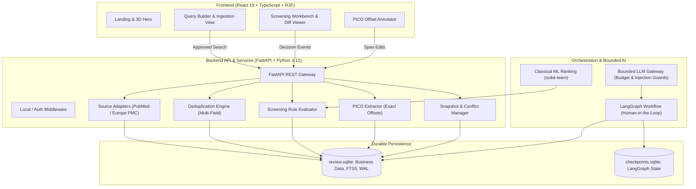

# Evidra — Autonomous & Collaborative Systematic Literature Review Engine

[](https://github.com/balledasivavaraprasad-create/Evidra/actions)
[](https://www.python.org/)
[](https://react.dev/)
[](https://threejs.org/)
[](https://langchain-ai.github.io/langgraph/)
[](https://www.sqlite.org/)

**Evidra** is an enterprise-grade systematic literature review platform designed to accelerate scientific, medical, and evidence synthesis without compromising clinical rigor or provenance. Built for Track 1, Evidra combines **deterministic baseline algorithms**, **LangGraph human-in-the-loop workflows**, and **snapshot-based review loops** to deliver a reliable, auditable alternative to traditional review tools.

---

## What Evidra Delivers

1. **Deterministic Level 1 Review Engine (Zero-LLM Required):**
   - **Multi-Source Ingestion:** Live integrations with PubMed E-Utilities and Europe PMC REST APIs with rate limits and quota safeguards.
   - **Rigorous Deduplication:** Identifies duplicate records using exact identifiers (DOI/PMID), normalized title hashing, and multi-field matching while strictly differentiating *multiple reports of the same clinical study* from *duplicate publications*.
   - **Explainable Screening:** Rule-based inclusion/exclusion criteria evaluating population, study design, animal studies, and simulations with logged rationale and snippet evidence.
   - **Exact PICO Span Annotation:** Extracts Population, Intervention, Comparator, and Outcome spans mapped directly to Unicode half-open code-point offsets `[start, end)` with SHA-256 text fingerprinting.
   - **Reviewer Workbench:** Full manual override capabilities, optimistic concurrency protection, append-only decision audit trails, and sanitized CSV/RIS export.

2. **Level 2 Iterative Review Loop (Immutable Snapshots):**
   - **Decision Preservation:** Re-running searches or adding query terms preserves prior human screening decisions and PICO edits.
   - **Group Conflict Resolution:** When newly imported papers merge previously separated study groups with conflicting human decisions, Evidra highlights visible conflicts instead of silently guessing.
   - **Snapshot-Based Diff & Revert:** Exact one-click restoration of historical corpus versions directly from SQLite without re-fetching external APIs.

3. **Premium Visuals & Safe AI Augmentation:**
   - **Interactive 3D Experience:** WebGL/Three.js hero with React Three Fiber, smooth dark-mode aesthetics, responsive typography, and reduced-motion fallback.
   - **Leakage-Free Classical ML:** Optional scikit-learn ranking trained exclusively on validated historical decisions.
   - **Bounded LangGraph RAG Assistant:** Bounded, cited corpus question answering with strict prompt-injection defenses and fail-closed budget caps.

---

## Architectural Blueprint



---

## Four-Person Delivery Roster & Branch Ownership

Evidra is organized into 4 parallel work streams governed by [24 implementation prompts](prompts/README.md), the [canonical merge order](prompts/EXECUTION-AND-MERGE-ORDER.md), and the [Buddy Reviewer Guide](docs/BUDDY-GUIDE.md):

| Persona | Teammate | Focus Area | Branch Prefix | Allowed Paths |
|---|---|---|---|---|
| **dev-A** | T1 — Full Stack | React 19 product, design system, R3F 3D hero, review workbench, deployment | `feat/dev-a-01` to `06` | `frontend/`, `infra/` |
| **dev-B** | T2 — AI/ML | Deduplication engine, screening rules, baseline evaluation, group regressions | `feat/dev-b-01` to `06` | `backend/app/dedup/`, `screening/`, `evals/` |
| **dev-C** | T3 — AI/Agentic RAG | PICO exact offsets, LangGraph pipelines, agent injection defenses, bounded RAG | `feat/dev-c-01` to `06` | `backend/app/pico/`, `workflows/`, `gateway/` |
| **dev-D** | T4 — Backend Lead | SQLite schema, migrations, OpenAPI contracts, literature adapters, snapshots | `feat/dev-d-01` to `06` | `backend/app/api/`, `db/`, `contracts/`, `sources/` |

---

## Documentation Index

1. [Buddy & Teammate Reviewer Guide](docs/BUDDY-GUIDE.md): The master reference for branch management, PR review checklist, domain invariants, and execution waves.
2. [Master Execution & Merge Order](prompts/EXECUTION-AND-MERGE-ORDER.md): The canonical 24-step merge queue and dependency runbook.
3. [Developer Prompts Hub](prompts/README.md): Individual assignment prompts for dev-A, dev-B, dev-C, and dev-D.
4. [CI and Contract Conventions](prompts/CI-AND-CONTRACTS.md): Migration head rules, lockfile ownership, and staged CI promotion.
5. [Complete Implementation Plan](docs/implementation-plan.md): Scope, requirements (R00–R26), and delivery gates.
6. [Team Execution & Schedule](docs/team-execution.md): 72-hour timeline and handoff boundaries.
7. [Architecture & Schema](docs/architecture.md): SQLite schema, API endpoints, identity model, and concurrency.
8. [Algorithms & Data Sources](docs/algorithms-and-sources.md): Deduplication rules, screening heuristics, and PICO models.
9. [Agents, RAG & Security](docs/agents-and-security.md): LangGraph state graph, injection prevention, and model budgeting.
10. [Premium Frontend Design](docs/frontend-design.md): Typography, color palette, 3D WebGL guidelines, and accessibility.
11. [Level 2 Loop Design](docs/loop-design.md) & [Submission PDF](output/pdf/level-2-loop-design.pdf): One-page architectural blueprint for iterative reviews.
12. [Verification, Release & Timed Demo](docs/verification-and-release.md): Testing matrix, regression suite, and acceptance checklist.
13. [Dependencies Policy](docs/dependencies.md), [References](docs/references.md), and [Audit Ledger](audit.md).

---

## Getting Started & Local Verification

### 1. Prerequisites
- **Python:** `3.12+` with `uv` package manager (`curl -LsSf https://astral.sh/uv/install.sh | sh`)
- **Node.js:** `>= 24.22.1` with `npm`
- **Docker & Docker Compose:** Optional for single-host container deployment

### Hosted demo on Render

See [docs/deploy-render.md](docs/deploy-render.md): set up from `render.yaml`, private behind a shared site password, with the demo review preloaded.

### 2. Single-Host Docker Deployment (Fastest)
```bash
# Build and run the entire unified system (Backend API + Frontend SPA + SQLite WAL)
# Production mode needs a secret key and the shared site password people will type to open it
export SECRET_KEY=$(python3 -c "import secrets; print(secrets.token_urlsafe(32))")
export SITE_PASSWORD='choose-a-password'
docker compose -f infra/docker-compose.yml up --build

# Verify readiness
curl http://localhost:8000/health/ready
# Open your browser at http://localhost:8000
```

### 3. Local Development Quickstart

#### Backend (FastAPI + SQLite WAL)
```bash
cd backend
# 1. Install locked dependencies
uv sync --frozen

# 2. Run linear database migrations
uv run --locked alembic upgrade head

# 3. Start development server on port 8000 (or 8800)
uv run --locked uvicorn app.main:app --host 127.0.0.1 --port 8000 --reload
```

#### Frontend (React 19 + TypeScript + Vite + Three.js)
```bash
cd frontend
# 1. Install dependencies
npm ci

# 2. Check contract drift
npm run api:check

# 3. Start Vite dev server on port 5173
npm run dev
# Open http://localhost:5173 in your browser
```

### 4. Running Verification Test Suites
```bash
# Backend test suite (167 tests covering contracts, operations, security, algorithms, level2, and AI)
cd backend && uv run --locked pytest -q

# Frontend test suite (21 unit tests, typecheck, production build)
cd frontend && npm run test:unit && npm run typecheck && npm run build

# CI Stage Validation
python3 scripts/ci/validate_stage.py
python3 scripts/ci/run_checks.py backend
python3 scripts/ci/run_checks.py frontend
```

### 5. Reproducing Algorithm Evaluations
```bash
# Runs full benchmark suite: Deduplication, Screening, Classical ML Ranking, PICO, LLM, RAG
python evals/run_all_evals.py
# Outputs: evals/manifest.json and evals/final_evaluation_results.json
```

### 6. Quiescent SQLite Backup & Restore Runbook
```bash
# Create point-in-time quiescent backup (WAL-safe with SHA-256 manifest)
cd backend && uv run --locked python -c "
from pathlib import Path
from app.services.backup import create_backup
m = create_backup(Path('backups/manual_snapshot'))
print('Backup created:', m.databases['primary'].sha256)
"

# Test restore to a fresh target directory
uv run --locked python -c "
from pathlib import Path
from app.services.backup import restore_backup
r = restore_backup(Path('backups/manual_snapshot'), Path('restored_data'), overwrite=True)
print('Restore successful:', r['status'])
"
```

---

## Operational Health Endpoints
- **Liveness Probe:** `GET http://localhost:8000/health/live` (process responsiveness)
- **Readiness Probe:** `GET http://localhost:8000/health/ready` (SQLite connection, Alembic head, and disk space > 10MB)
- **Interactive OpenAPI Documentation:** `http://localhost:8000/docs`

---

## Project Invariants
- **Offset Integrity:** PICO offsets are half-open Unicode code-point indices `[start_cp, end_cp)` into immutable abstract text.
- **Data Preservation:** Records are never deleted upon exclusion; review decisions are append-only events.
- **Deterministic Baseline:** Level 1 runs with zero reliance on cloud LLMs or GPUs.
- **No Hallucinated Evidence:** Lack of evidence produces a `Maybe` verdict, never an invented exclusion.
- **Human Reviewer Sovereignty:** Machine models provide suggestions; reviewer actions are recorded with cryptographic and optimistic concurrency protection.

