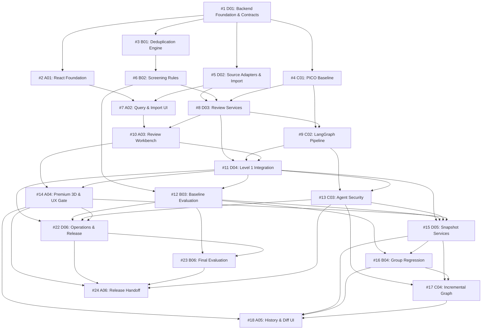

# Evidra Teammate & Buddy Reviewer Guide

> **Project:** Evidra (Advanced AI-Assisted Systematic Literature Review Platform)  
> **Repository:** [https://github.com/balledasivavaraprasad-create/Evidra.git](https://github.com/balledasivavaraprasad-create/Evidra.git)  
> **Target Track:** Track 1 — Autonomous Systematic Literature Review Engine  
> **Architecture:** React 19 + Three.js/R3F | Python 3.12 + FastAPI + SQLite (WAL/FTS5) | LangGraph Orchestration  

---

## 1. What We Are Building: Evidra at a Glance

Evidra is a systematic literature review platform designed to eliminate research fatigue and human error across medical, clinical, and scientific syntheses. Inspired by tools like Rayyan and Covidence, Evidra elevates literature reviews into a reproducible, deterministic, and AI-augmented experience.

### The Problem Evidra Solves
Systematic reviews require researchers to synthesize hundreds or thousands of biomedical publications. The process suffers from:
1. **Search Overload:** Querying PubMed / Europe PMC returns overlapping, messy records.
2. **Duplicate Inaccuracies:** Merging conference abstracts with follow-up full clinical trials inappropriately distorts study groupings.
3. **Screening Inconsistencies:** Inclusion/exclusion criteria applied subjectively without logged rationale or verifiable metadata.
4. **PICO Tagging Errors:** Failure to precisely bind Population, Intervention, Comparator, and Outcome to exact textual offsets in abstracts.
5. **Loss of Work During Iterations:** Modifying a query or adding a new search term historically meant re-screening everything from scratch or losing previous reviewer decisions.

### Evidra's Core Capabilities
- **Level 1 Core (100% Deterministic Baseline):**
  - Interactive multi-database query builder (PubMed E-Utilities + Europe PMC REST) with boolean logic, date limits, and live count previews.
  - Durable ingestion pipeline storing raw provenance, canonical records, and query memberships.
  - Deterministic deduplication (exact DOI, normalized title, multi-field matching) while strictly preserving the distinction between *different reports of the same study* vs. *duplicate copies of the same paper*.
  - Explainable rule-based screening with structured reasons and metadata-first detection (human species, clinical design, simulation exclusion, case report exclusion).
  - Exact PICO span annotation using half-open Unicode code-point offsets into immutable abstract text.
  - Full human-in-the-loop review workbench with optimistic concurrency locks, complete audit logs, and sanitized CSV/RIS export.
  - Complete Level 1 runs with LLM disabled, requiring zero API keys or external GPU services.

- **Level 2 Core / Bonus (The Iterative Review Loop):**
  - One-page immutable loop architecture.
  - Query revisions and criteria updates preserve past reviewer decisions.
  - Stable study groups and explicit merge conflict detection when conflicting human decisions meet.
  - Snapshot-based diffing (added, removed, newly merged papers).
  - Exact state restoration from immutable snapshots without re-querying live external APIs.

- **Bounded AI & Premium Polish:**
  - Original 3D landing hero (React Three Fiber / Three.js / Drei) with reduced-motion fallback and strict bundle budgets.
  - Optional classical ML ranking (scikit-learn SGD/PassiveAggressive) evaluated with zero data leakage.
  - Bounded LangGraph agentic workflow with checkpointing, human-in-the-loop pause/resume, and strict security guardrails against prompt injection.

---

## 2. The Buddy & Reviewer Operating Model

As the team's pair-programming buddy and technical coordinator, my role is to:
1. **Guide Context & Scope:** Ensure each developer works exclusively in their allocated domain without circular dependencies or conflicting file edits.
2. **Review Every Branch & PR:** Apply strict, invariant-backed review criteria before code is merged into `main`.
3. **Guard Core Domain Invariants:** Prevent data loss, ensure text offset validity, verify study vs. paper separation, and protect immutable snapshot integrity.
4. **Maintain CI Integrity:** Enforce staged CI promotion (`.ci/stages.json`) and run local validation before merge.

---

## 3. Team Roster, Branches, and File Ownership

The project splits accountability across 4 specialized roles (24 structured prompts: 17 required, 4 bonus, 3 optional).

| Teammate ID | Role | Core Responsibility | Primary Branches | Allowed File Roots |
|---|---|---|---|---|
| **dev-A** (T1) | Full Stack & UI Lead | React 19 foundation, Tailwind/CSS design system, 3D Hero (R3F), Query & Import UI, Review Workbench, PICO annotator, Version History UI, deployment | `feat/dev-a-01-react-foundation`<br>`feat/dev-a-02-query-import-ui`<br>`feat/dev-a-03-review-workbench`<br>`feat/dev-a-04-premium-3d`<br>`feat/dev-a-05-history-ui`<br>`feat/dev-a-06-release-handoff` | `frontend/`<br>`infra/`<br>`docs/frontend-results.md` |
| **dev-B** (T2) | AI / ML & Evaluation | Deduplication engine, screening rule criteria, baseline evaluation fixtures, group merge/split regressions, optional ML ranking, final evaluation report | `feat/dev-b-01-deduplication`<br>`feat/dev-b-02-screening-rules`<br>`feat/dev-b-03-baseline-evaluation`<br>`feat/dev-b-04-group-regression`<br>`feat/dev-b-05-ml-ranking`<br>`feat/dev-b-06-final-evaluation` | `backend/app/dedup/`<br>`backend/app/screening/`<br>`backend/tests/algorithms/`<br>`evals/` |
| **dev-C** (T3) | Agentic RAG, PICO & Security | Exact-span PICO baseline, durable LangGraph pipeline, agent boundaries & injection guardrails, incremental graph replay, optional LLM gateway, bounded corpus RAG | `feat/dev-c-01-pico-baseline`<br>`feat/dev-c-02-langgraph-pipeline`<br>`feat/dev-c-03-agent-security`<br>`feat/dev-c-04-incremental-graph`<br>`feat/dev-c-05-llm-assistance`<br>`feat/dev-c-06-bounded-rag` | `backend/app/pico/`<br>`backend/app/workflows/`<br>`backend/app/gateway/`<br>`backend/app/retrieval/`<br>`backend/tests/workflows/`<br>`backend/tests/agent_security/` |
| **dev-D** (T4) | Backend Lead & Foundation | SQLite schema & migrations, Alembic, Pydantic & OpenAPI contracts, literature source adapters (PubMed/Europe PMC), reviewer events, Level 1 integration, snapshots, operations | `feat/dev-d-01-foundation-contracts`<br>`feat/dev-d-02-source-import`<br>`feat/dev-d-03-review-services`<br>`feat/dev-d-04-level1-integration`<br>`feat/dev-d-05-snapshot-services`<br>`feat/dev-d-06-operations-release` | `backend/app/api/`<br>`backend/app/contracts/`<br>`backend/app/db/`<br>`backend/app/services/`<br>`backend/app/sources/`<br>`backend/migrations/`<br>`contracts/`<br>`.ci/stages.json` |

---

## 4. Canonical Merge Sequence & Dependencies

Every PR must be branched from an up-to-date `main` and merged strictly in dependency order:



---

## 5. How the Buddy Reviews Every Pull Request

When a teammate submits a pull request, follow this exact step-by-step checklist:

### Step 1: Pre-flight Verification
- [ ] **Branch Naming:** Matches prompt specification (e.g., `feat/dev-b-01-deduplication`).
- [ ] **Upstream Dependency Check:** All prerequisites listed in `prompts/tasks.json` are already merged into `main`.
- [ ] **Scoped Paths:** PR only touches files within the developer's `allowed_paths`.
- [ ] **Lockfile Ownership:**
  - Only dev-D modifies `backend/pyproject.toml` and `backend/uv.lock`.
  - Only dev-A modifies `frontend/package.json` and `frontend/package-lock.json`.
- [ ] **Handoff Document:** PR includes a completed `prompts/handoffs/<ID>.md` citing the parent commit SHA, verification commands, and newly unblocked work.

### Step 2: Domain Invariant Audit
- [ ] **Never Delete Records:** Review actions set disposition / flags (`is_hidden`, `decision_state`). No raw record is ever deleted by SQL `DELETE`.
- [ ] **Study vs. Paper Separation:** Distinct papers reporting on the same clinical trial are linked to the same study group, but remain distinct source records.
- [ ] **Unicode Half-Open Offsets for PICO:**
  - Offsets must be `[start_codepoint, end_codepoint)` in Python Unicode codepoints.
  - Abstract text must have an accompanying SHA-256 hash.
  - Browser UTF-16 conversions must be verified in dev-A's annotator.
- [ ] **Explainable Screening Reasons:** Every exclusion must have an evidence key, snippet, and category. "Unknown" must yield `Maybe`, never an assumed exclusion.
- [ ] **Immutable Snapshots:** Reverting to an old snapshot reads saved rows directly from SQLite. Never refetches from live network APIs.
- [ ] **Zero ML Data Leakage:** Any scikit-learn models (dev-B) must be evaluated with strict group/holdout splitting, never evaluated on training corpus.
- [ ] **Agent Safety (LangGraph & Gateway):**
  - Prompt injection sanitization active on all retrieved text.
  - LLM disabled by default. When enabled, strict request limits, rate limits, and budget caps apply.
  - Graph interrupts pause at human review checkpoints and cleanly resume.

### Step 3: Local CI & Test Execution
Before approving and merging, run the required test suite locally:
```bash
# Validate planning and prompt dependencies
python3 scripts/validate_planning.py
python3 scripts/validate_prompts.py
python3 scripts/validate_ml_addendum.py

# Run planning test suite
python3 -m unittest discover -s tests/planning -p "test_*.py"

# Run CI checks for the current stage
python3 scripts/ci/run_checks.py backend
python3 scripts/ci/run_checks.py frontend
```

---

## 6. Git Protocol for Teammates

### Starting a Task
```bash
# 1. Ensure main is up to date
git checkout main
git pull origin main

# 2. Create feature branch matching task ID
git checkout -b feat/dev-b-01-deduplication

# 3. Work on assigned files within allowed paths
```

### Submitting Work
```bash
# 1. Run local tests
pytest backend/tests/...  # or npm run test:unit

# 2. Fill in handoff file
cp prompts/handoffs/TEMPLATE.md prompts/handoffs/B01.md
# (Fill in merge SHAs, test outputs, notes)

# 3. Commit and push
git add backend/app/dedup/ backend/tests/algorithms/dedup/ prompts/handoffs/B01.md
git commit -m "feat(dedup): implement deterministic deduplication engine (B01)"
git push -u origin feat/dev-b-01-deduplication
```

### Merging to Main
- The Integration Captain verifies the review checklist.
- The PR is merged using Squash & Merge (or clean rebase merge).
- The merge commit SHA is recorded in `audit.md` and subsequent handoffs.

---

## 7. Emergency Contacts & Troubleshooting
- **Peer Conflicts:** If npm complains about peer resolution, use the pinned versions in `docs/dependencies.md`. Never use `--force` or `--legacy-peer-deps`.
- **Alembic Conflicts:** If two branches create migrations, only dev-D may resolve the merge head into a single linear chain.
- **Contract Mismatches:** If frontend needs an extra API field, request the contract change from dev-D first before implementing UI consumption.
