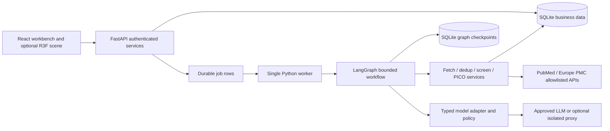

# Architecture, schema and interface freeze

## Components and boundaries

Backend modules are planned as `app/api`, `app/contracts`, `app/db`, `app/services`, `app/sources`, `app/dedup`, `app/screening`, `app/pico`, `app/workflows`, `app/retrieval`, `app/gateway`. Application code is not implemented by this planning package. A sync SQLAlchemy session per unit of work is sufficient; do not share sessions across threads. Network operations and model calls occur outside DB write transactions.

## Identity: do not collapse these concepts

- **Source record:** one provider identifier, such as `(pubmed, PMID)` or `(europepmc, source namespace, id)`. Repeated retrieval of the same source ID is idempotent.
- **Record revision:** immutable normalized metadata/text for that source record at a point in time, with content hash and raw-response provenance. Re-fetch never silently changes historical text.
- **Paper group:** records believed to describe the same publication. A group has one representative; all members remain stored. Cross-provider copies may share a group.
- **Study link:** distinct publications reporting the same trial. Optional relation, never a deduplication edge by itself.
- **Query version:** immutable search intent and source-specific settings.
- **Search execution:** a timestamped count/ID acquisition for a query version. A live rerun can change results without changing the text; preserve each execution.
- **Corpus revision:** frozen selected query executions, record revisions, group snapshot and output references. It is the object that can be reopened exactly.

This reconciles “one stored record found by several searches” with “retain duplicate records”: upsert repeat source identities, but retain independently sourced records and group their duplicate representations.

## Proposed database schema

Use UUID strings for application IDs, UTC ISO timestamps, JSON validated by Pydantic for structured payloads. Composite foreign keys or service checks enforce workspace consistency. All FKs indexed. The initial Alembic migration is authored by T4 and reviewed before merging.

Implement this schema in stages rather than building every table before the first UI flow. G0/G1 needs workspaces, criteria/query versions, search executions, source records/revisions, query memberships, jobs and run logs. G2 adds immutable groups/snapshots, machine results, review events and annotations. Level 2 adds lineage/conflict/diff projections and complete restore behavior. Membership roles/authentication must exist before any remotely accessible deployment. Simple join tables and JSON evidence payloads keep migrations small; avoid building a generic event-sourcing framework.

| Table | Important columns and constraints |
|---|---|
| `workspaces` | id PK, title, created_by, current_revision_id nullable, row_version |
| `reviewers`, `workspace_members` | actor id, authentication subject; membership role reviewer/admin/viewer; no user-supplied actor identity |
| `criteria_versions` | id PK, workspace_id, sequence UNIQUE per workspace, question/PICO JSON, criteria JSON, hash, created_at |
| `query_versions` | id PK, workspace_id, parent_id nullable, sequence, Boolean AST, dates, source options, criteria_version_id, hash; immutable |
| `search_executions` | id PK, query_version_id, source, exact translated query, synonym setting, hit_count, counted_at, status, partial flag, cap, raw hash |
| `source_records` | id PK, workspace_id, source, source_namespace, external_id; UNIQUE over these identity columns |
| `record_revisions` | id PK, source_record_id, content_hash, title, abstract_text nullable, structured_sections JSON, authors JSON, year nullable, journal, pages, language list, publication_types JSON, DOI/PMID and source metadata, fetched_at; UNIQUE(record_id,content_hash) |
| `query_memberships` | search_execution_id, source_record_id, record_revision_id; UNIQUE(execution,record); never deleted on selection changes |
| `corpus_revisions` | id PK, workspace_id, parent_id, criteria_version_id, dedup_version, state building/published/failed, published_at, decision_seq_cutoff, fingerprint |
| `corpus_queries`, `corpus_members` | revision_id + selected execution ids; revision_id + record_revision_id; UNIQUE pairs |
| `paper_groups` | id PK, workspace_id, membership_fingerprint; group ID never recycled |
| `group_members` | group_id, source_record_id; UNIQUE pair; immutable after group creation |
| `group_snapshots` | corpus_revision_id, group_id, representative_revision_id; UNIQUE(revision,group) |
| `group_lineage` | parent_group_id, child_group_id, operation merge/split/extend, corpus_revision_id; preserve all parents |
| `dedup_edges` | ordered record-id pair, evidence JSON, score, method_version, proposed/confirmed/rejected, reviewer_event_id optional; workspace scoped |
| `machine_results` | id PK, corpus_revision_id, group_id, record_revision_id, stage, input_fingerprint, method/model/prompt versions, output JSON, created_at; UNIQUE(stage,input_fingerprint,scope) |
| `review_events` | id PK, monotonic sequence, workspace_id, group_id, event_type, payload, actor_id, reason, supersedes_event_id nullable, created_at; append-only |
| `pico_annotations` | event/result reference, record_revision_id, label P/I/C/O, start_cp, end_cp, quote, provenance; overlap allowed across labels |
| `review_conflicts` | id, revision_id, group_id, conflicting event ids, kind, resolution_event_id nullable |
| `jobs` | id, workspace_id, kind, request_key UNIQUE scoped to actor/workspace/kind, payload_hash, state, lease_owner, lease_until, attempt, cancellation flag |
| `runs`, `run_steps` | run/job/revision/query refs, graph_version, stage, attempt, fingerprints, timestamps, status, error_code, trace_id, model use/cost |
| `exports` | id, revision_id, decision_seq_cutoff, export schema version, checksum, created_by, created_at |

Do not require DOI uniqueness in raw source rows: contradictory metadata is possible. DOI/PMID are dedup evidence; hard source-identity uniqueness prevents repeated imports. Store raw payloads in a controlled local artifact directory referenced by hash, with retention limits and rights notes. Do not publish copyrighted abstract dumps by default.

## Transactions, concurrency and recovery

Enable `foreign_keys=ON`, `journal_mode=WAL`, a 5-second busy timeout and short transactions. SQLite WAL permits readers alongside a writer but still has a single writer, and is unsuitable for a shared network filesystem ([SQLite documentation](https://www.sqlite.org/wal.html)). Use one API process and one job worker on a single host for the hackathon; serialize writes through short units of work, not a process-local lock alone.

Publish a corpus revision only after all required references are consistent. Building revisions never replace the currently published revision. Failed imports remain visible as partial jobs and can resume. Store an import page and its cursor/progress checkpoint in the same transaction. A lease expires after worker death; a replacement worker claims it atomically. Every stage checks a unique input fingerprint before writing an output.

Reviewer command transaction: validate workspace membership and expected row/event version → validate payload → append event → update current projection/version → append audit metadata → commit. Return HTTP 409 if stale. A retry with the same idempotency key and same payload returns its original result; the same key with a different payload returns conflict. Persist job enqueue within the business transaction so an API crash cannot lose a submitted job.

Graph checkpoint and business DB commits are not one distributed transaction. Therefore node replay must detect already committed domain outputs. Do not claim exactly-once network/model execution; achieve idempotent domain effects. Backup through SQLite's backup API or a coordinated stop/checkpoint, never copy only the main file while WAL writes continue.

## Decision projection and group changes

1. Machine suggestions never overwrite human events. A current valid human decision takes precedence; absent a human decision, show the machine suggestion as such.
2. Repeated source record or unchanged group preserves its human decision across queries.
3. Extending/merging a group creates a new immutable group identity with parent lineage. If one parent has a decision, carry it as an attributed inherited decision. If parents agree, retain all provenance. If parents disagree, mark `conflict`, block inclusion in exports, and require resolution. Do not silently choose the newest event or highest confidence.
4. On split, original parent-specific events remain. A decision made for the merged group becomes a pending suggestion for each child until reviewed; do not pretend its scope was unambiguous. Restore rejected duplicate edges so the same incorrect merge does not recur.
5. PICO spans belong to **a text revision**, even though eligibility belongs to the group. On representative/text changes retain old annotations; mark them stale for the new text. Transfer only after exact substring/offset validation, otherwise request re-annotation.
6. Criteria changes preserve prior human decisions and mark them “review required under criteria vN.” The reviewer explicitly reaffirms or replaces them. Do not automatically discard them or quietly treat an old exclusion as newly validated.

## Revert and diff semantics

Dedup operates against the accumulated historical corpus, as the pre-read requests. Each published revision stores its active selected query executions, members, group partition and representative choices. A new bridge can merge groups in a new revision without rewriting the old one.

“Restore exact snapshot” reopens those saved records, text revisions, groups, criteria and machine results, plus decisions as of the recorded decision cutoff. It requires no live fetch, new model output or rerun of today's dedup algorithm. “Open old corpus with latest review decisions” is a separate, clearly labeled mode. New decisions are append-only even when reviewing an old corpus; historical snapshots remain recoverable. If the team only implements one mode, implement exact snapshot first.

Diff compares saved member identities: added, removed-from-active-view (not deleted), retained, text-changed, group merges/splits, representative changes and pending conflicts. Report source-record counts and unique paper-group counts separately. A same-query fresh execution is explicitly a refresh, not exact revert.

## Contract freeze: service and HTTP interface

Pydantic contracts are the source of truth. Export OpenAPI and generate TypeScript types; do not maintain hand-copied duplicate schemas. Enums: eligibility `include|exclude|maybe`; effective state also `conflict|needs_review`; job `queued|running|waiting_human|succeeded|partial|failed|cancelled`; PICO `P|I|C|O`.

| Endpoint (planned `/api/v1`) | Request / response contract |
|---|---|
| `POST /workspaces`, `POST /workspaces/{id}/criteria` | Validated question/criteria → immutable version |
| `POST /workspaces/{id}/queries` | Boolean AST, dates, sources, parent → query version |
| `POST /queries/{id}/searches` | Source and options → count/search execution job |
| `POST /workspaces/{id}/imports` | Approved execution IDs, cap, idempotency key → job id |
| `GET /jobs/{id}` | Status, stage, progress, counts, partial/truncation, structured error |
| `GET /workspaces/{id}/revisions` | Published/building revisions with provenance |
| `GET /revisions/{id}/groups` | Cursor pagination, filters, group representative and effective decision |
| `GET /groups/{id}?revision_id=...` | Member revisions, evidence, machine results, events, conflicts |
| `POST /groups/{id}/decisions` | Revision, expected version, status, reason → saved event/version |
| `POST /groups/{id}/pico` | Record revision/hash, expected version, spans → validated event |
| `POST /workspaces/{id}/dedup-decisions` | Pair/group operation, expected version, reason → event and new revision job |
| `POST /conflicts/{id}/resolve` | Expected version, chosen status, reason → resolution event |
| `GET /revisions/{id}/diff?base=...` | Added/removed/changed/group lineage summary |
| `POST /workspaces/{id}/restore` | Snapshot id and explicit mode → current view update, no deletion |
| `POST /revisions/{id}/exports` | Confirmed export scope → CSV and manifest |
| `POST /workspaces/{id}/assistant` | Revision-scoped task and question → bounded cited proposal; optional |

Errors use `{code,message,retryable,trace_id,details}` with sanitized details. Poll jobs every 1–2 seconds with backoff; SSE is deferred. Backend enforces caps and ownership even if UI disables controls. UI cancels stale requests and keys caches by workspace, revision and filters.

**Offsets:** zero-based, half-open Unicode code-point indices into the exact stored `abstract_text`; hash accompanies edits. Python slicing follows code points; browser JavaScript strings use UTF-16, so use `Array.from(text)` or an explicit conversion map for selections. For every span require `0 <= start < end <= len(text)` and `text[start:end] == quote`. Do not normalize whitespace after offsets are created. This is a cross-team contract, not a UI implementation detail.
