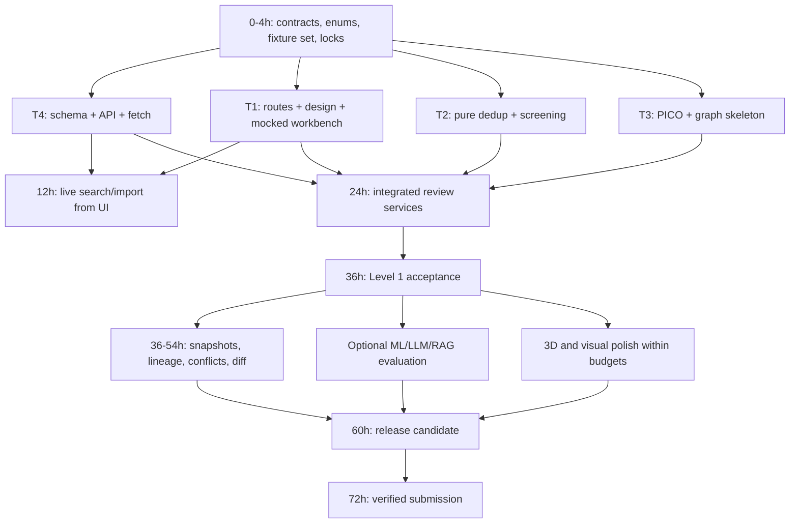

# Four-person parallel execution and Git plan

## Ownership matched to the supplied strengths

| Teammate | Accountable scope | Owns application paths | Secondary review |
|---|---|---|---|
| T1 — Full stack | React product, design system, R3F hero, annotation UI, integration, deployment and demo | `frontend/`, `infra/`, UI/e2e tests | T4 reviews API integration; T3 checks annotation semantics |
| T2 — AI/ML | Deduplication, screening rules, optional classical ML, evaluation fixtures and metrics | `backend/app/dedup/`, `screening/`, `backend/tests/algorithms/`, `evals/` | T4 reviews group writes; T3 reviews evidence logic |
| T3 — AI/agentic RAG/ML | PICO rules first, LangGraph orchestration, optional model/RAG assistance, model guardrails | `backend/app/pico/`, `workflows/`, `gateway/`, `retrieval/`, their tests | T2 reviews PICO evaluation; T4 reviews permissions/idempotence |
| T4 — Backend | SQLite schema/migrations, API contracts, source adapters, jobs, reviewer events, snapshots and authorization | `backend/app/api/`, `contracts/`, `db/`, `services/`, `sources/`, migrations and integration tests | T1 reviews usable contracts; T2 reviews dedup semantics |

T4 owns Python manifest/lock edits; T1 owns frontend manifest/lock edits. T4 owns central OpenAPI/Pydantic contracts. T1 owns generated TypeScript regeneration. T4 owns migrations; modules return typed results instead of creating tables. Everyone owns tests for their domain; T3 coordinates security checks, not all security implementation. T1's full-stack capacity shifts to exports/job UI or API integration after the frontend shell; T2/T3 pair on fixtures to avoid duplicated data work.

## Dependency graph and deliverable handoffs



**Foundation handoff, hour 4:** canonical records, `ScreenResult`, `PicoResult`, `DedupProposal`, job/status enums, error envelope and offset convention; 12–20 synthetic fixtures; generated OpenAPI or agreed schema examples; initial migration; lockfiles; owner map. T2/T3 must not wait for working databases: build pure methods against those fixtures. T1 mocks the frozen API contract with the same fixtures.

**T4 → T2:** immutable normalized records and group service interface. **T2 → T4:** pair evidence/proposals and eligibility outputs, with no persistence side effects. **T3 → T4:** spans and graph result fingerprints, no direct reviewer-table writes. **T4 → T1:** versioned routes with statuses, expected-version fields and error examples. **T1 → others:** UI acceptance gaps and precise failure payloads, not alternate business rules.

## Timeline in elapsed event hours

| Window | T1 full stack | T2 AI/ML | T3 AI/agents | T4 backend | Integration gate |
|---|---|---|---|---|---|
| 0–4 | Routes, tokens, layouts, API mock contract | Question/criteria, dedup/screen fixtures | PICO schema, graph plan, security boundaries | Contracts, schema, migrations, env/locks | Foundation commit consumed by all |
| 4–8 | Query form, result table, static hero | Exact dedup, normalization, rule criteria | PICO offsets/rules, graph smoke | PubMed count/fetch, membership persistence | First local API/UI wiring |
| 8–12 | Live search/import UI and hour-12 artifacts | Multi-field matching, uncertain pairs | Persistent graph/job integration | Jobs/retries, Europe PMC basic mapping | Required steps 1–3 and written designs |
| 12–18 | Review queue, errors, decision controls | Screen reasons, metadata gaps | PICO corrections contract, missing labels | Reviewer events, dedup service integration | No direct model/database coupling |
| 18–24 | PICO editor, duplicate panel, export UI | False-merge/negation tests, metrics | Graph restart/interrupt tests, PICO evaluation | Exports, optimistic locks, source partial recovery | Integrated functional walkthrough |
| 24–30 | Responsive/accessibility pass, initial R3F | Fix algorithm failures; ML experiment only if free | Security failures and deterministic fallback | Durable run logs, data integrity fixes | Candidate Level 1 |
| 30–36 | Complete primary workflows; premium basics | Validate holdout + all baseline criteria | Validate PICO; LLM-off workflow | Fresh DB migration/restore, API tests | G3: Level 1 complete |
| 36–44 | Query history + conflict UI | Group-bridge/split logic with T4 | Optional LLM PICO + budgeted gateway | Immutable snapshots and decision lineage | Exclusion survives a new query |
| 44–52 | Diff UI; refine one 3D scene | ML rank comparison + negative pairs | Bounded retrieval assistant if measurable | Exact revert + selective recompute | Bonus tests; cut failed experiments |
| 52–60 | Deployment, performance, report formatting | Metrics/report tables and limitations | Adversarial tests + AI evaluation results | Backups, startup/recovery, judge-access plan | G5: release candidate/report draft |
| 60–68 | Timed demo, responsive/visual corrections | Hidden-style fixtures, sanity review | LLM failure drills, tracing review | Clean-machine deployment rehearsal | Feature freeze; only fixes |
| 68–72 | Repository handoff/demo availability | Report proofread/results validation | Provenance and evidence check | Release tag/backup/run instructions | Submission checklist completed |

Each window is coordination guidance, not uninterrupted individual work. Schedule two overlapping review periods each day and rotate the integration watch. Protect sleep; avoid critical merges when an owner is unavailable.

## Branch strategy

The executable assignments are now [24 developer prompts](../prompts/README.md), with [prompt-by-prompt merge order](../prompts/EXECUTION-AND-MERGE-ORDER.md). They map T1→dev-A, T2→dev-B, T3→dev-C, T4→dev-D. Use their exact `feat/dev-…` branch names and prerequisites; the branch names below are earlier illustrative examples. The prompt runbook is authoritative for sequencing, while this document explains the ownership and time budget.

Use a protected `main` and short feature branches. Do not create four permanent divergent branches or an additional long-lived develop branch. Names identify owner and feature, for example:

- `chore/foundation-contracts` (T4, merged first)
- `feat/t1-review-shell`, `feat/t1-pico-editor`, `feat/t1-3d-hero`
- `feat/t2-dedup`, `feat/t2-screening`
- `feat/t3-pico-baseline`, `feat/t3-langgraph`, `feat/t3-rag-assistant`
- `feat/t4-source-import`, `feat/t4-review-events`, `feat/t4-snapshots`

After a remote is created by the team, use the following routine from the correct checkout (commands are instructions, not actions already performed):

```sh
git fetch origin
git switch main
git pull --ff-only
git switch -c feat/t2-screening
# Implement only owned scope, run applicable checks, commit a cohesive slice.
git push -u origin feat/t2-screening
```

Push small working slices every 2–4 focused hours. PR description states requirement IDs, contract changes, validation, dependency PRs and affected owners. One teammate reviews each cross-boundary PR. Merge in dependency order; after the supplied CI workflow runs on the real repository, protect `main` with its stable **CI Gate** check.

### How to push dependencies early without merge conflicts

1. For a new field, T4 first publishes a small **additive contract PR** containing schema/type/example changes and an optional/null-compatible path. Consumers review before implementation.
2. Merge that PR to `main`; all dependent branches update. Providers and UI then implement independently against the same contract. Avoid each feature branch adding its own version of the field.
3. If a stacked PR is unavoidable, declare its base branch and `Depends on` PR explicitly. After the parent merges, retarget/rebase only the child branch. Do not cherry-pick the same parent into several branches and also merge it later.
4. Shared lockfile changes are queued through the manifest owner. If concurrent requests arrive, owner resolves the union once; everyone runs frozen installs. Never resolve lockfile conflicts by keeping arbitrary halves.
5. Migration revisions serialize through T4. Rebase and regenerate a not-yet-applied migration if needed; never rewrite a migration already applied to shared review data. CI checks one Alembic head and upgrades from the last released schema.
6. T1 regenerates API types from the merged OpenAPI snapshot. Generated code is not manually edited to hide incompatibilities.
7. For shared CSS/layout changes, use feature components and tokens. The hero branch owns only `features/landing/scene/`; it does not reformat the review workbench.

Use `--force-with-lease` only on one's own unpublished/shared-by-agreement feature branch after a rebase; never force-push `main` or another teammate's work. No force push is necessary for routine merging. Review the semantic result after conflict resolution, then rerun the affected workflow.

## Coordination artifacts

One integration captain per 6-hour block (rotate T4/T1). Standups at hours 4, 12, 24, 36, 48, 60 and 68 answer: demonstrated slice, next contract dependency, blocking test, proposed cut. Keep each under 10 minutes.

To prevent everyone editing `audit.md`, the integration captain updates it after merges. Each PR supplies its evidence and requirement IDs. Algorithm owners maintain domain notes in their own directories. Root instructions and architecture changes need affected-owner review. No repository remote currently exists in this workspace; branch names and push steps are planned, not already executed.
