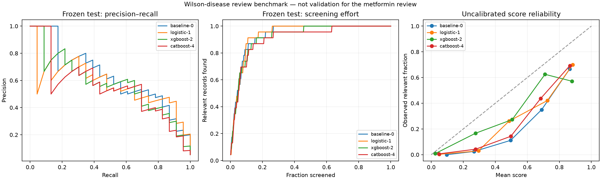

# ML upgrade: results and reproduction

Implemented and measured on 29 October 2026. This directory is additive; the historical `evals/ml/` and `evals/ml_c/` artifacts remain intact.

## Result

The bounded comparison ran TF-IDF/logistic regression, heterogeneous ColumnTransformer/logistic regression, XGBoost 3.4.1 and CatBoost 1.2.10. Both tree families had a sparse-feature and an SVD variant. Each candidate also had a separately fitted sigmoid-calibration variant where the development data supported it. Model selection used development precision at a development-selected threshold meeting 95% recall, then F2 and average precision, with a deterministic preference for the simpler model on ties. The test set was not used for tuning or selecting a family.

**The original-style logistic model won this bounded development selection. No new artifact was promoted to the running metformin review.** This is an honest non-promotion, not evidence that boosted trees can never work better. The original application artifact stays active; the new feature pipeline and challenger artifacts are supported by the runtime for a properly scoped future promotion.

### Frozen-test comparison

The first, uncalibrated configuration of each family is shown here. The complete table, calibration variants, SVD variants, confidence intervals, confusion matrices and latency evidence are in [the measured report](wilson-final/report.json) and [comparison table](wilson-final/REPORT.md).

| Candidate | Accuracy | Precision | Recall | F1 | Average precision | WSS@95 |
|---|---:|---:|---:|---:|---:|---:|
| TF-IDF/logistic baseline | 0.8715 | 0.2838 | 0.9130 | 0.4330 | 0.6362 | 0.7304 |
| ColumnTransformer/logistic | 0.8178 | 0.2222 | 0.9565 | 0.3607 | 0.5844 | 0.7748 |
| XGBoost, sparse features | 0.5818 | 0.1139 | 1.0000 | 0.2044 | 0.5803 | 0.6907 |
| CatBoost, sparse features | 0.8061 | 0.2059 | 0.9130 | 0.3360 | 0.5574 | 0.6813 |

The validation recall target did not guarantee test recall: the baseline found 21 of 23 test positives at its frozen threshold. WSS@95 is an oracle benchmark of ranking effort, not a production screening-stop rule or the same quantity as the fraction left unscreened. Calibrated and uncalibrated variants can have the same ranking/classification metrics while differing in Brier score and log loss.



## Data and limitations

- Public source: Appenzeller-Herzog et al.'s Wilson-disease therapy review, distributed through ASReview/SYNERGY; [review reference](https://doi.org/10.1111/liv.14179), [dataset index](https://github.com/asreview/synergy-dataset).
- Download: [tagged CSV](https://raw.githubusercontent.com/asreview/systematic-review-datasets/metadata-v1-final/datasets/Appenzeller-Herzog_2020/output/Appenzeller-Herzog_2020.csv). Licence listed by the dataset index: CC-BY-4.0; attribution retained in the protocol and candidate manifest. Raw abstracts are not committed here.
- Raw CSV SHA-256: `456f9306b0ce1aee840ac0244f11df3b2a168aa46007a92f5dcf59916d309a69`.
- 3,453 raw rows; 3,193 identity/leakage groups after supplied duplicate links, DOI and normalized-title links. Quarantined 91 rows in contradictory-label groups, 1 group without a title, and 1,025 groups without adequate abstracts. The latter belong in a manual-review lane; benchmark results apply only to the remaining coverage.
- 2,142 usable representatives, 116 positive title/abstract-screening labels. These are **not final full-text-inclusion labels**. Production deduplication is unchanged by benchmark grouping.
- Split: train 1,286/70 positives; calibration 215/12; development selection 213/11; frozen test 428/23. Exact IDs and hashes are in [splits](wilson-final/splits.json).
- Known study IDs were unavailable. This split protects available publication/duplicate identities, but cannot establish complete clinical-study isolation. This is one within-review holdout, not nested cross-validation, prospective validation, or across-review generalization evidence.
- This topic is not the metformin review. A new metformin deployment needs appropriately scoped human-labelled evaluation data. Synthetic fixture scores do not replace that requirement.
- Tree count was fixed at 100 and each boosting family had two configurations. The budget is a quick comparison, not exhaustive optimization. The optional train-internal early-stopping helper is implemented/tested, but was not used to claim these results. No native CatBoost-text experiment, large embeddings, stacking or formal uncertainty guarantee is claimed.
- A final metadata/hash correction rerun preserved the same seed, splits, hyperparameters and selection policy. It was not a test-driven retuning cycle. Earlier incomplete runs were discarded; `wilson-final/` is the authoritative result.

## Reproduce

From the repository root:

```sh
uv sync --locked --project backend --group ml-benchmark
curl --fail --location https://raw.githubusercontent.com/asreview/systematic-review-datasets/metadata-v1-final/datasets/Appenzeller-Herzog_2020/output/Appenzeller-Herzog_2020.csv -o /tmp/evidra-wilson-review.csv
backend/.venv/bin/python evals/ml_upgrade/prepare_synergy.py /tmp/evidra-wilson-review.csv /tmp/evidra-wilson-normalized.json
backend/.venv/bin/python evals/ml_upgrade/run_comparison.py --dataset /tmp/evidra-wilson-normalized.json --output /tmp/evidra-new-comparison --trials 2 --iterations 100
backend/.venv/bin/python evals/ml_upgrade/plot_comparison.py /tmp/evidra-new-comparison
backend/.venv/bin/python evals/ml_upgrade/run_active_learning.py /tmp/evidra-wilson-normalized.json /tmp/evidra-active-learning.json
```

Use a new output directory for each comparison; the runner refuses to overwrite evidence. Verify the raw SHA-256 above before treating a download as the same benchmark.

On this Mac, XGBoost needed OpenMP. The existing scikit-learn wheel supplied `sklearn/.dylibs/libomp.dylib`; the measured command prefixed the comparison with:

```sh
DYLD_LIBRARY_PATH="$PWD/backend/.venv/lib/python3.12/site-packages/sklearn/.dylibs" backend/.venv/bin/python evals/ml_upgrade/run_comparison.py --dataset /tmp/evidra-wilson-normalized.json --output /tmp/evidra-new-macos-comparison --trials 2 --iterations 100
```

This is a local benchmark workaround, not a portable system dependency installation. A deployed Mac boosting model needs a verified OpenMP runtime. The optional Linux group uses `xgboost-cpu==3.4.1` to avoid NCCL/CUDA downloads. Linux wheels were resolved in the lock; an actual Linux runtime execution has not been performed here.

Ordinary CI/core startup does not need the benchmark group, public dataset downloads or an LLM key. Native estimator imports happen only when that family is requested. Training remains an explicit offline action.

## Active-learning experiment

[Simulation results](active-learning.json) compare relevance-first, mixed relevance/uncertainty/exploration and seeded random selection. Each run started with the same two known positives/two known negatives and reviewed 100 records. On two seeds, mixed selection found 31–32 positives, relevance-first found 29, and random found 6. These are retrospective oracle-measured counts on this dataset; no prospective time savings, robust superiority or automatic stopping rule is established. The learner fits only on labels already revealed. This experiment does not automatically retrain production when a reviewer clicks a button.

## Deployment and rollback

`wilson-final/candidate/` contains an integrable **Wilson-scoped** candidate and provenance. It is not the active application model. The runtime accepts the original text schema or the new `heterogeneous-v1` schema through the same verified scoring adapter. Both public ranking APIs use the canonical scoped service; explicitly supplied legacy artifacts remain a compatibility path for callers/tests.

For a future approved, trusted, correctly scoped bundle, configure `EVIDRA_ML_ARTIFACT_DIR` on the server and install the estimator's matching optional group if needed. The value is deployment configuration, not an API parameter. Verify the complete bundle and evaluate its declared scope before enabling it. Roll back by removing this override and restarting the API, which restores the original artifact path. All model outputs and human decisions remain separate; changing the model does not rewrite saved human history.

Hashes detect inconsistent bytes, not authenticity of a malicious artifact plus rewritten manifest. Never load untrusted joblib/pickle bundles. The deployment directory is the trust boundary; schema/runtime checks and pre-deserialization hash verification are enforced.

## Verification

See [the implementation handoff](../../prompts/handoffs/C-ML-UPGRADE.md) for exact verification, baseline failures, conflict-minimizing scope and remaining limitations. No hosted CI or production deployment is claimed.
